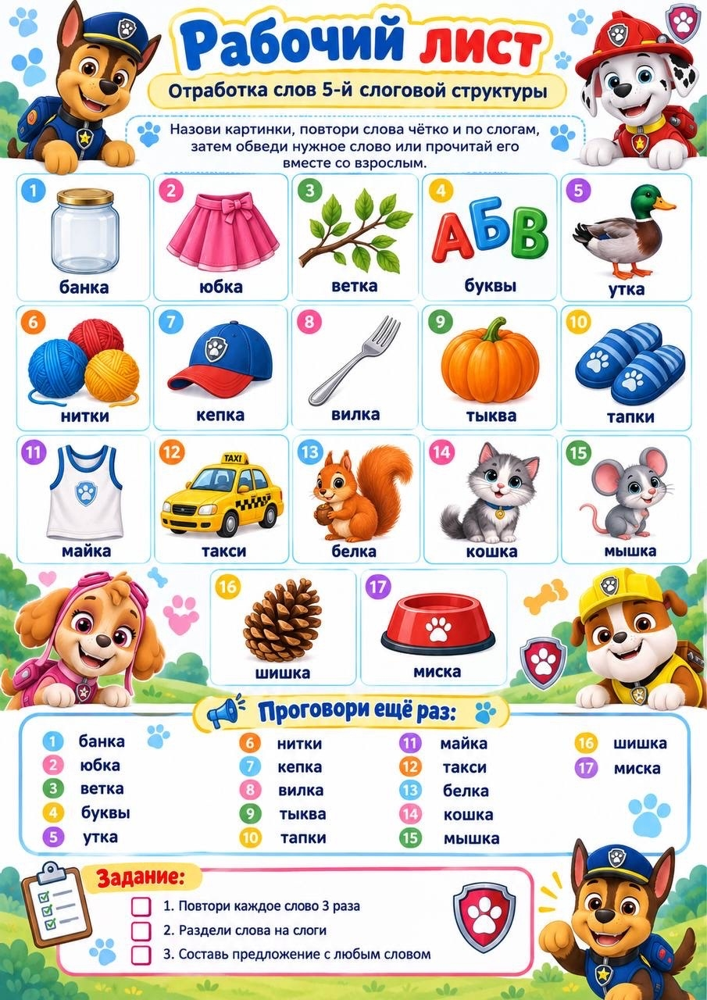
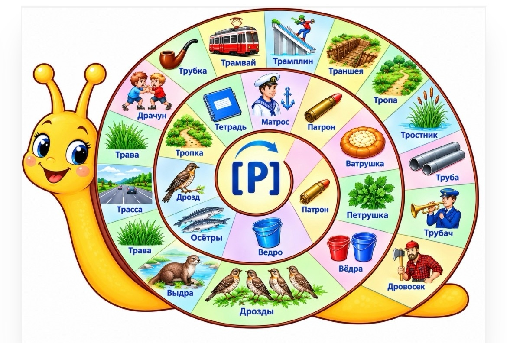
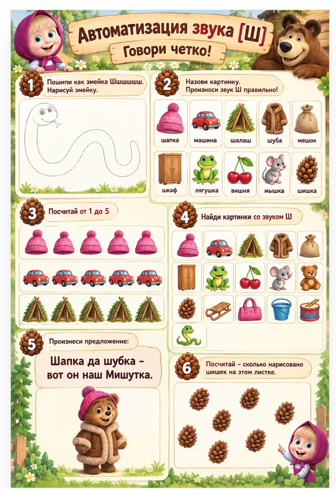

<!-- Источник: input/Соколова О.В._Представление опыта работы_Рабочие листы_ИИ.docx -->

# Рабочие листы с использованием ИИ

## Черновое распознавание текста на изображениях

> Автоматическое распознавание Windows OCR. Возможны ошибки в словах и порядке строк. При сверке используйте изображения выше; этот раздел не является проверенным текстом автора.

### image-001.jpg

Рабочий лист  
Отработка слов 5-й слоговой структуры  
Назови картинки, повтори слова чётко и по слогам,  
затем обведи нужное слово или прочитай его  
вместе со взрослым.  
00 ОАКА6в04  
банка  
нитки  
майка  
банка  
юбка  
ветка  
буквы  
утка  
юбка  
кепка  
такси  
шишка  
ветка  
вилка  
белка  
буквы  
тыква  
кошка  
миска  
Проговори ещё раз:  
утка  
тапки  
мышка  
шишка  
миска  
нитки  
кепка  
вилка  
тыква  
тапки  
майка  
такси  
белка  
кошка  
мышка  
Задание:  
1. Повтори каждое слово 3 раза  
О 2 Раздели слова на слоги  
3. Составь предложение с любым словом

### image-002.jpg

Драчун  
Трава  
Трасса  
Трава  
Матрос  
Тетрадь  
Траншея¯  
Тропа  
Тростник  
Тропка  
Дрозд  
Осётры  
Ватрушка  
Петрушка  
Труба  
Трубач  
Выдра  
Ведро  
Дрозды

### image-003.jpg

Автоматизация звука [Ш]  
Говори четко!  
Пошипи как змейка Шшшшшш.  
Назови картинку.  
Нарисуй змейку.  
Посчитай от 1 до 5  
Произнеси предложение:  
Шапка да шубка -  
вот он наш Мишутка.  
Произноси звук Ш правильно!  
шалаш шуба мешок  
шапка  
машина  
шкаф лягушка вишня  
мышка  
шишка  
Найди картинки со звуком Ш  
9  
Посчитай — сколько нарисовано  
шишек на этом листке.
