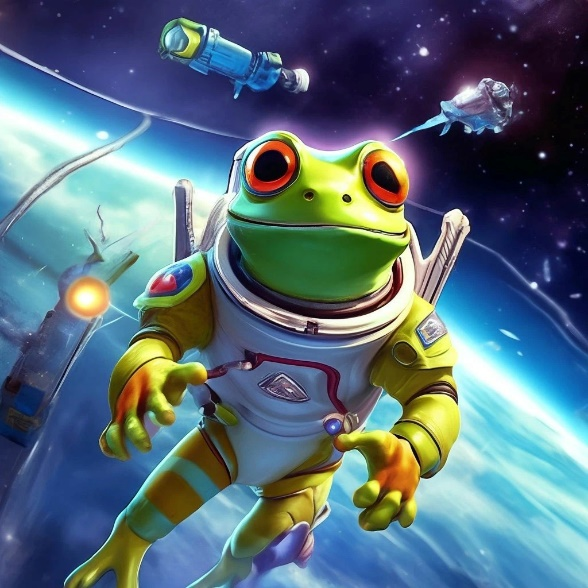
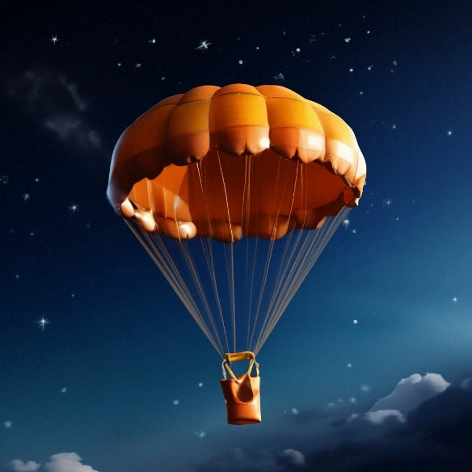
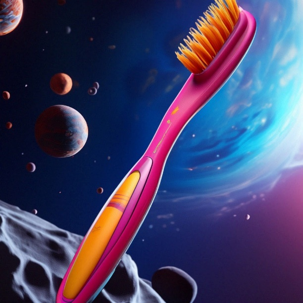
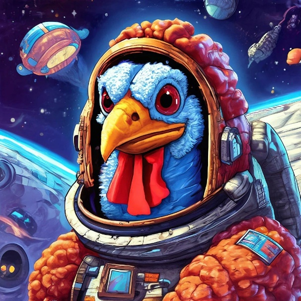
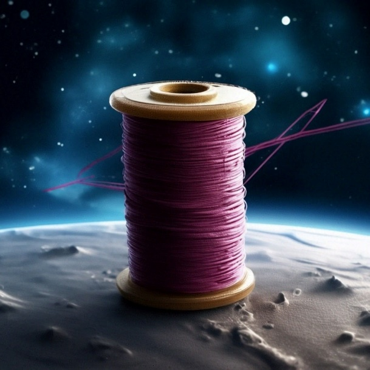

<!-- Источник: input/Соколова О.В. Картотека Артикуляционная гимнастика.docx -->

# Картотека артикуляционной гимнастики

**Муниципальное бюджетное дошкольное образовательное учреждение**

**детский сад компенсирующего вида № 40**

**Картотека учителя-логопеда Соколовой О.В.**

**КАРТОТЕКА**

**АРТИКУЛЯЦИОННОЙ ГИМНАСТИКИ**

(описание классических упражнений артикуляционной гимнастики со стихотворениями и графические символы упражнений артикуляционной гимнастики на лексическую тему «Космос»)

**_1.«Улыбка»_**

_Широка наша река,_

_И улыбка широка._

_Зубки все мои видны –_

_От краев и до десны._                                    

**_Цель:_** вырабатывать умение удерживать губы в улыбке, обнажая нижние и

верхние передние зубы. Укреплять мышцы губ и развивать их подвижность.

**_Описание:_** Улыбнуться без напряжения так, чтобы были видны передние верхние

 и нижние зубы. Удержать мышцы губ в таком положении под счёт от 1 до 5-10.

**_2.«Хоботок»_**

_Я слегка прикрою рот,_

_Губы – «хоботом» вперед._

_Далеко я их тяну,_

_Как при долгом звуке: у-у-у._

**_Цель:_** вырабатывать движение губ вперед, укреплять мышцы губ, их

подвижность.

**_Описание:_** Вытянуть сомкнутые губы вперёд «трубочкой». Удерживать их в

таком положении под счёт от 1 до 5-10.

**_3.«Домик открывается»_**

_Ротик широко открыт,_

_Язычок спокойно спит._

**_Цель:_** научиться спокойно открывать и закрывать рот, расслабляя мышцы языка. Удерживать губы и язык в заданном положении.

**_Описание:_** Слегка улыбнуться,  медленно открыть рот (как для пропевания  звука «а»: «а-а-а»), подержать рот открытым 5-10 секунд, медленно закрыть.

**_4\. Чередование «Хоботок» - «Улыбка» -_**

 **_«Домик открывается»_**

_Улыбается ребенок,_

_Хобот вытянул слоненок._

_Вот зевает бегемот,_

_Широко открыв свой рот._

**_Цель:_** укреплять мышцы губ и тренировать их подвижность путем переключения позиций губ. Развивать произвольное внимание.

**_Описание:_** Упражнение выполняется в форме игры «Делай, как я». Взрослый выполняет поочерёдно движения губами в любом порядке («у – и – а», «а – у - и»,

 «и – у - а»),удерживая губы в каждой позиции 3-5 секунд, а ребёнок повторяет.

**_5\. «Любопытный язычок»_**

_Вот и вышел на порог_

_Любопытный язычок._

_«Что он скачет взад-вперед?» -_

_Удивляется народ._

**_Цель:_** укреплять мышцы языка, развивать его подвижность.

**_Описание:_** Улыбнуться, слегка приоткрыть рот и производить движения языком вперёд-назад. Язык кладём на нижнюю губу, затем убираем его в рот. Рот

остаётся открытым. Упражнение выполняется 8-10 раз.

**_6.«Лягушка»_**

_Ниже нижнюю губу_

_Опущу я, как смогу._

**_Цель:_** отрабатывать движение нижней губы вниз и на место. Развивать

 подвижность и укреплять мышцы губ.

**_Описание:_** Ребёнок опускает нижнюю губу, обнажая нижние зубы, и возвращает

 её на место. Упражнение выполняется до 10 раз.

**_7\. «Зайчик»_**

_Губку верхнюю подняв,_

_Замер зайчик, зубки сжав._

**_Цель:_** отрабатывать движение верхней губы вверх и на место. Развивать подвижность и укреплять мышцы губ.

**_Описание:_** Ребёнок поднимает верхнюю губу, обнажая верхние зубы, и опуская

её обратно. Упражнение выполняется до 10 раз.

**_8\. «Окошко»_**

_Рот прикрою я немножко,_

_Губы сделаю «окошком»._

_Зубки рядышком стоят_

_И в окошечко глядят._

**_Цель:_** развивать мышечную силу и подвижность губ.

**_Описание:_** Зубы почти сомкнуты. Губы принимают положение окошечка. Удерживать их в таком положении 5-10 секунд.

**_9\. «Язык здоровается с подбородком»_**

_Просыпается язык –_

_Долго спать он не привык._

_И спросил у подбородка:_

_\- Эй, какая там погодка?_

**_Цель:_** отрабатывать движение языка вниз, развивать его подвижность. Укреплять мышцы языка. Способствовать растяжке подъязычной связки – уздечки (при ее укорочении).

**_Описание:_** Улыбнуться, приоткрыть рот и широким языком дотянуться вниз (к подбородку), затем убрать язык в рот. Проделать упражнение 5-10 раз.

**_10\. «Язык здоровается с верхней губой»_**

_Улыбнись, не будь груба,_

_Здравствуй, верхняя губа!_

**_Цель:_** отрабатывать движение языка вверх, укреплять мышцы языка и развивать

его подвижность. Способствовать растяжке подъязычной связке (уздечки), если

она укорочена.

**_Описание:_** Слегка улыбнуться, приоткрыть рот, положить широкий край языка

на верхнюю губу. Подержать язык на верхней губе 3-5 секунд, убрать в рот.

**_11\. «Обезьянка»_**

_За нижнюю губку заложен язык –_

_Из зеркала смотрит мартышкин двойник._

**_Цель:_** отрабатывать движение языка вниз с одновременным выполнением более тонких движений. Укреплять мышцы языка.

**_Описание:_** Чуть приоткрыть рот и поместить язык между нижней губой и

нижними зубам. Удержать его в таком положении не менее 5 секунд.

**_12\. «Бульдог»_**

_За верхнюю губку заложен язык –_

_Бульдог уступать никому не привык._

**_Цель:_** тренировать подъем языка с одновременным выполнением более тонких движений. Укреплять мышцы языка.

**_Описание:_** Чуть приоткрыть рот и поместить язык между верхней губой и

верхними зубами. Удерживать язык в таком положении не менее 5 секунд.

**_13 «Прятки» (чередование «Обезьянка» - «Бульдог»)_**

_Обезьянка и бульдог –_

_Всем покажет язычок._

**_Цель:_** укреплять мышцы языка и губ, развивать подвижность языка. Тренировать способность к переключению с одной позиции на другую (низ – верх).

**_Описание:_** Ребёнок в спокойном темпе попеременно выполняет упражнения «Обезьянка» и «Бульдог».

**_14\. «Хомячок»_**

_Языком давить стараюсь,_

_В щеку сильно упираюсь._

_Раздалась моя щека,_

_Как мешок у хомяка._

**_Цель:_** развивать произвольные движения языка. Укреплять мускулатуру языка и щек.

**_Описание:_** Язык поочерёдно упирается в правую и левую щёки, задерживаясь в каждом положении на 3-5 секунд.

**_15\. «Кружок»_**

_Мой язык совсем не глуп –_

_Ходит кругом возле губ._

**_Цель:_** развивать произвольные движения языка, укреплять его мускулатуру и развивать его подвижность. Самомассаж мышц губ и щек.

**_Описание:_** Рот закрыт. Язык движется с внутренней стороны, плавно очерчивая кончиком языка круг (правая щека – под верхней губой – левая щека – под

 нижней губой). Затем язык двигается в обратном направлении. «Нарисовать» по

 5-6 кругов в одну и другую сторону.

**_16\. Чередование «Толстячки - худышки»_**

_Вот толстяк – надуты щеки_

_И, наверно, руки в боки._

_Вот худышка – щеки впали:_

_Видно, есть ему не дали._

**_Цель:_** укреплять мускулатуру щек. Развивать координацию движений.

**_Описание:_** Ребёнок поочерёдно надувает и втягивает щёки в спокойном темпе, удерживая их в каждом положении 3-5 секунд.

**_17\. «Шарики» (поочерёдное надувание щёк)_**

_Шарик слева, шарик справа,_

_Есть у нас одна забава:_

_В щеки дуем – чередуем,_

_То в одну, а то в другую._

**_Цель:_** укреплять мускулатуру щек. Развивать координацию движений и умение переключаться.

**_Описание:_** Ребёнок в спокойном темпе поочерёдно надувает правую и левую

 щёки, как бы перегоняя воздух из одной щёки в другую.

**_18\. «Самовар»_**

_Щеки надую и выпущу пар,_

_И запыхчу, как большой самовар._

**_Цель:_** укреплять мускулатуру губ и щек.

**_Описание:_** Сжать губы, надуть щёки, удержать воздух 2-3 секунды и выпустить через губы, произнося «Пых!».

**_19\. «Шлёпаем губами по языку»_**

_А теперь уж не зубами –_

_Я пошлепаю губами:_

_«У быка губа тупа,_

_Па-па-па, па-па-па»._

**_Цель:_** расслаблять мышцы языка путем самомассажа (пошлёпывания губами). Научиться удерживать язык распластанным, широким.

**_Описание:_** Улыбнуться, приоткрыть рот, спокойно положить на нижнюю губу и, пошлёпать его губами, произносить: «па-па-па». Рекомендуем поэтапное выполнение упражнения:

-   пошлёпать губами кончик языка;
-   пошлёпать губами середину языка;
-   пошлёпать губами язык, подвигая его медленно вперёд, а затем назад.

**_20\. «Чашечка»_**

_Улыбаюсь, рот открыт:_

_Там язык уже стоит._

_К зубкам подняты края –_

_Вот и «чашечка» моя._

**_Цель:_** научиться удерживать язык в форме чашечки наверху, у верхних зубов. Укреплять мускулатуру языка.

**_Описание:_**  Улыбнуться, открыть рот и установить язык наверху в форме

 чашечки.

**_21\. «Вкусное варенье»_**

_Как будто варенье лежит на губе –_

_Слижу его «чашечкой» в ротик себе._

**_Цель:_** отрабатывать движение широкой передней части языка в форме чашечки вверх. Укреплять  мышцы языка.

**_Описание:_** Улыбнуться, открыть рот и языком в форме чашечки облизывать губу, делая движение сверху вниз. Можно продолжить движение и убрать язык в рот, не разрушая «чашечку».

**_22.«Ступеньки_» (_Чередование «чашечка» на верхней_** **_губе – «чашечка» на верхних зубах – «чашечка»_**  **_вверху за зубами)_**

_На верхнюю губку,_

_На верхние зубки,_

_За зубки скачок – и молчок._

**_Цель:_** удерживать язык в форме чашечки, развивать его подвижность. Укреплять мускулатуру языка. Вырабатывать умение менять положение языка, не разрушая «чашечку».

**_Описание:_** Улыбнуться, открыть рот, установить язык в форме чашечки на

верхней губе, затем перевести «чашечку» на верхние зубы, а затем за верхние

зубы. Удерживать в каждом положении 3-5 секунд.

**_23\.  «Фокус» («Дуем с чашечки»)_**

_Я «чашку» выведу вперед,_

_С нее подую вверх._

_И теплый воздух обдает_

_Мой носик, например._

**_Цель:_** направлять воздушную струю по середине языка и вверх, удерживая язык в форме чашечки на верхней губе.

**_Описание:_** Улыбнуться, приоткрыть рот, положить широкий передний край

языка на верхнюю губу так, чтобы боковые края его были прижаты, а посередине был небольшой желобок. Затем плавно подуть вверх, на нос.

**_24 .«Не разбей чашечку»_**

_Широко открыт мой рот,_

_Ходит «чашка» взад-вперед._

**_Цель:_** производить движения языком в форме чашечки, не разрушая ее. Развивать мускулатуру и подвижность языка.

**_Описание:_** Придать языку форму «чашечки» и двигать его: выдвигать вперёд и убирать обратно в рот. Удерживать язык снаружи и внутри по 3-5 секунд, не разбирая «чашечки».

**_25\. «Чистим верхние зубы» (с внутренней стороны)_**

_Зубы верхние – смотри:_

_Чищу «чашкой» изнутри._

**_Цель:_** развивать подвижность языка, укреплять кончик языка. Отрабатывать

подъем языка.

**_Описание:_** Улыбнуться, открыть рот и широким языком «почистить» верхние

зубы с внутренней стороны, делая движения из стороны в сторону.

**_26\. «Покусаем язычок»_**

_Выдвигай свой язык,_

_Чтоб лениться не привык._

_И от кончика до корня_

_Я кусаю все проворней._

**_Цель:_** добиваться расслабления мышц языка, усиления кровоснабжения мышц языка, улучшения иннервации (нервной проводимости).

**_Описание:_**  Улыбнуться, приоткрыть рот и покусать язык.

_Варианты:_ 1\. Покусать кончик языка. 2. Покусать середину языка. 3. Покусывать язык, продвигая его постепенно вперёд-назад. Во время выполнения упражнения произносить: «та-та-та». Произношение слогов («та-та-та») помогает ребёнку выполнять задания.

**_27.«Кусаем боковые края языка»_**

_«Горкой» выгну язычок,_

_Пожую ему бочок:_

_Левый, правый, оба сразу_

_Я жую как по заказу._

**_Цель:_** преодолевать спастичность (напряженность) языка путем самомассажа (покусывания боковых краев языка), способствовать прилеганию краев языка к нижним боковым зубам.

**_Описание:_** Улыбнуться, спеть: «и-и-и» (язык расширится) – и, не меняя

положения языка, покусать его края боковыми зубами 10 – 15 раз.

**_28.«Чистим зубы снаружи»_**

_Зубки верхние снаружи_

_Нам почистить очень нужно._

_Зубки нижние – не хуже,_

_Тоже чистки просят дружно._

**_Цель:_** отрабатывать произвольные движения языка, развивать координацию движений. Укреплять мускулатуру языка.

**_Описание:_** Улыбнуться, показать зубы, широким языком медленно провести с наружной стороны зубов, имитируя чистящее движение. Так же «чистим» наружную сторону нижних зубов.

**_29.«Загоним мяч в ворота»_**

_Щек своих не надуваю,_

_Мяч в ворота загоняю._

**_Цель:_** научиться выпускать длительную направленную воздушную струю.

**_Описание:_** Вытянуть губы вперёд «трубочкой» и длительно подуть на шарик

 (лежит на столе перед ребёнком), загоняя его между двумя кубиками.

_Варианты:_ можно предложить ребёнку на вертушку, мелкие игрушки, которые легко катятся по столу, ватку (сдуть с ладошки), направленная воздушная струя хорошо вырабатывается, если предложить ребёнку подуть в небольшую чистую бутылочку (из-под капель). При точном попадании воздушной струи в бутылочку раздаётся своеобразный гудящий или свистящий звук («гудит пароход»). Это очень нравится детям.

**_30.«Лопаточка»_**

_Поперек улыбки лег –_

_Отдыхает язычок._

**_Цель:_** вырабатывать умение удерживать язык в свободном, расслабленном положении, лежащим на нижней губе.

**_Описание:_** Улыбнуться, приоткрыть рот, положить широкий передний край

 языка на нижнюю губу. Удерживать его в таком положении под счёт от 1 до 5-10.

**_31.«Дуем на лопаточку»_**

_Дую, дую на «лопатку»,_

_Чтоб была широкой, гладкой._

**_Цель:_** вырабатывать умение дуть по середине широкого языка, спокойно

лежащего на нижней губе.

**_Описание:_** Улыбнуться, приоткрыть рот, положить широкий край языка на

нижнюю губу и спокойно подуть по середине языка.  

**_32.«Горка» («мостик»)_**

_Улыбаюсь, рот открыт –_

_Там язык лежит, свернувшись._

_В зубы нижние уткнувшись,_

_Горку нам изобразит._

**_Цель:_** научиться удерживать язык в положении, необходимом для произношения свистящих звуков. Развивать мускулатуру языка, укреплять кончик языка.

**_Описание:_** Улыбнуться, приоткрыть рот, кончик языка поставить за нижние зубы, широкий язык установить «горкой». Удерживать в таком положении под счёт от 1 до 5-10.

**_33.«Ветерок дует с горки»_**

_С горки дует ветерок,_

_И несет он холодок._

**_Цель:_** научиться удерживать язык в положении, необходимом для произношения свистящих. Укреплять мышцы языка. Научиться дуть по середине языка плавно и длительно.

**_Описание:_** Улыбнуться, приоткрыть рот. Установить язык «горкой», а затем спокойно и плавно подуть по середине языка. Воздух должен быть холодным.

**_34.«Мостик построим – мостик разрушим»_**

_Ставлю я язык «дугой»_

_И кладу – даю покой._

**_Цель:_** научиться попеременно напрягать и расслаблять мышцы языка.

**_Описание:_** Улыбнуться, установить кончик языка за нижние зубы, напрячь язык, чтобы он принял положение мостика или горки («Мостик построим»). Удержать язык в расслабленном и напряжённом состоянии по 3-5 секунд.

**_35.«Чистим нижние зубы»_** **_(с внутренней стороны)_**

_Ходит «горка» влево – вправо,_

_Чистит зубки очень браво._

**_Цель:_** научиться удерживать кончик языка за нижними зубами. Укреплять кончик языка, развивать подвижность языка.

**_Описание:_** Улыбнуться показать зубы, приоткрыть рот и кончиком языка «почистить» нижние зубы с внутренней стороны.

**_36.«Катушка»_**

_Широко раскрою рот,_

_«Горку» выведу вперед._

_И, назад отодвигая,_

_Я ее не разрушаю._

**_Цель:_** развивать подвижность языка и укреплять его мускулатуру.

**_Описание:_** Улыбнуться, открыть рот. Кончик языка упирается в нижние зубы. Широкий язык «выкатывать» вперёд и убирать в глубь рта. Упражнение

повторить 8-10 раз в спокойном темпе.

**_37.«Жуём блинчик»_**

_Вот опять язык свернулся,_

_В зубы нижние уткнулся._

_Двину чуть его вперед,_

_Разжую его вот-вот._

**_Цель:_** научить ребенка распластывать язык в положении, нужном для свистящих звуков.

**_Описание:_** Улыбнуться, приоткрыть рот, поставить кончик языка за нижние зубы (как в упражнении «Горка»), потом выдвинуть его чуть вперёд и покусывать свёрнутый язык 10-15 раз.

**_38.«Гармошка»_**

_Присосу язык на нёбо,_

_А теперь смотрите в оба:_

_Ходит челюсть вверх и вниз –_

_У нее такой круиз._

**_Цель:_** развивать подвижность языка, укреплять кончик языка. Отрабатывать

подъем языка.

**_Описание:_** Улыбнуться, открыть рот (видны верхние и нижние зуб) и широким язычком «почистить» верхние зубы с внутренней стороны, делая движения из стороны в сторону.

**_39 .«Маляр»_**

_Язык – как кисточка моя,_

_И ею нёбо крашу я._

**_Цель:_** укреплять мышцы языка и развивать его подвижность.

**_Описание:_** Улыбнуться, открыть рот и «покрасить» кончиком языка твёрдое нёбо («потолок»), делая движения языком вперёд-назад.

**_40\. «Барабанщик»_**

_За зубами в бугорок_

_Бьёт широкий язычок._

**_Цель:_** отрабатывать подвижность языка и подготавливать его к вибрации, необходимой для звука «р». Укреплять мышцы языка (особенно кончика языка).

**_Описание:_** Улыбнуться, открыть рот и постучать кончиком языка за верхними зубами, звонко, отчётливо и многократно повторяя: «д-д-д». Звук «д» нужно произносить так, чтобы ощущалась выдыхаемая воздушная струя (дуем на кончик языка). Темп убыстряется постепенно.

_Варианты: 1. Стучим кончиком языка за верхними зубами, произнося: «дын-дын-дын» («звоночек»)._

-   _Стучим и произносим: «т-д-т-д» («скачет лошадка»)._
-   _Многократно произносим: «а-д-д-д», «а-д-д-д», «а-д-д-д» («песенка»)._

**_41 .«Лошадка»_**

_Рот широко открываю,_

_К нёбу язык прижимаю._

_Прыгает вниз язычок._

_И раздается щелчок._

**_Цель:_** отрабатывать подъём языка, подготавливать его к выработке вибрации, растягивать подъязычную связку (уздечку). Укреплять мышцы языка.

**_Описание:_** Улыбнуться, открыть рот и пощёлкать кончиком языка («лошадка

 цокает копытами»).

**_42\. «Грибок»_**

_Широко открою рот,_

_Будто щелкну я вот-вот._

_Присосу язык на нёбо,_

_Челюсть вниз – и вся учеба._

**_Цель:_** отрабатывать умение удерживать язык наверху в положении, необходимом для звука «р». Укреплять мышцы языка, растягивать подъязычную связку

(уздечку).

**_Описание:_** Улыбнуться, приоткрыть рот, присосать язык к нёбу, открывать и закрывать рот (как растягиваются меха гармошки). При этом растягивается подъязычная связка. Постепенно надо раскрывать рот всё шире и дольше удерживать язык в верхнем положении.

**_43\.  «Кучер»_**

_Губы вместе я сведу,_

_Через губы буду дуть._

_Поиграю я в игру_

_И скажу лошадке: «Тпру!»._

**_Цель:_** отрабатывать вибрацию губ  и языка, подготавливать артикуляционные органы к произношению «р». Развивать силу выдоха.

**_Описание:_** Сомкнуть губы и достаточно сильно подуть через них. Губы

вибрируют и слышен характерный звук «тпру-у-у».

_Варианты: положить между губ широкий край языка и подуть. Край языка_

_будет вибрировать вместе с губами («едем на мотоцикле»)._

**_44\. «Парус»_**

_Улыбаюсь, рот открыт:_

_«Парус» там уже стоит._

_Прислоню язык, смотрю,_

_К зубкам верхним изнутри._

**_Цель:_** удерживать язык за верхними зубами. Укреплять мышцы языка.

**_Описание:_** Улыбнуться, широко открыть рот, поставить язык за верхние зубы так, чтобы кончик языка крепко упирался в зубы. Удерживать 5-10 секунд.

**_45.«Иголочка»_**

_Улыбаюсь: вот шутник –_

_Узким – узким стал язык._

_Меж зубами, как сучок,_

_Вылез длинный язычок._

**_Цель:_** научиться делать язык узким и удерживать его в таком положении.

**_Описание:_** Открыть рот, язык высунуть как можно чаще, напрячь его, сделать

узким и удерживать в таком положении под счёт от 1 до 5-10.

**_46.«Маятник»_**

_Влево-вправо кончик ходит,_

_Будто места не находит._

**_Цель:_** укреплять мышцы языка, отрабатывать его подвижность.

**_Описание:_** Улыбнуться, приоткрыть рот, высунуть язык как можно дальше и производить им плавные движения от одного уголка рта к другому. Проделать упражнение 10-15 раз.

**_47.«Змейка»_**

_А у змейки язычок_

_Узок, тонок, как сучок._

_Ходит-ходит взад-вперед:_

_Как же он не устает?_

**_Цель:_** развивать подвижность языка, переменно выдвигая и убирая узкий язык.

**_Описание:_** Открыть рот и производить узким языком движения вперёд-назад

(«жало змейки»).

**_48.«Индюк»_**

_Широко открыт мой рот,_

_Язычок – назад – вперед._

_Лижет «чашечкой» губу_

_И «болбочет» на бегу._

**_Цель:_** отрабатывать подъем языка и подвижность кончика языка.

**_Описание:_** Приоткрыть рот, положить язык на верхнюю губу и производить движения кончиком языка по верхней губе вперёд и назад, стараясь не отрывать язык от губы, как бы поглаживая её. Темп движения постепенно убыстрять, затем включить голос, пока не послышится «бл-бл» (так «болбочет» индюк).

**_49.«Качели»_**

_«Чашкой» вверх_

_И «горкой» вниз_

_Гнется мой язык –_

_Артист!_

**_Цель:_** вырабатывать умение быстро менять положение языка, развивать его гибкость, подвижность. Развивать гибкость и подвижность кончика  языка.

**_Описание:_** Улыбнуться, показать зубы, приоткрыть рот, положить широкий язык

за нижние зубы (с внутренней стороны), удерживать в таком положении 3-5

секунд. Потом поднять широкий язык за верхние зубы (с внутренней стороны) и удерживать 3-5 секунд. Так, поочерёдно, менять положение языка 4-6 раз.

**_50.«Пароход»_**

_Вывожу язык вперед,_

_Закушу его – и вот:_

_«Ы» тяну – и к нам идет_

_Белый-белый пароход._

**_Цель:_** отрабатывать положение языка, необходимое для постановки «л»

 ( особенно при напряженности языка и замене твердого «л» на мягкий «ль»).

**_Описание:_**  Слегка улыбнуться, высунуть язык, зажать его зубами и петь звук

 «ы-ы-ы» («пароход гудит»).

**Графические символы упражнений артикуляционной гимнастики**

**на лексическую тему «Космос»**

 

 

 

 

 
