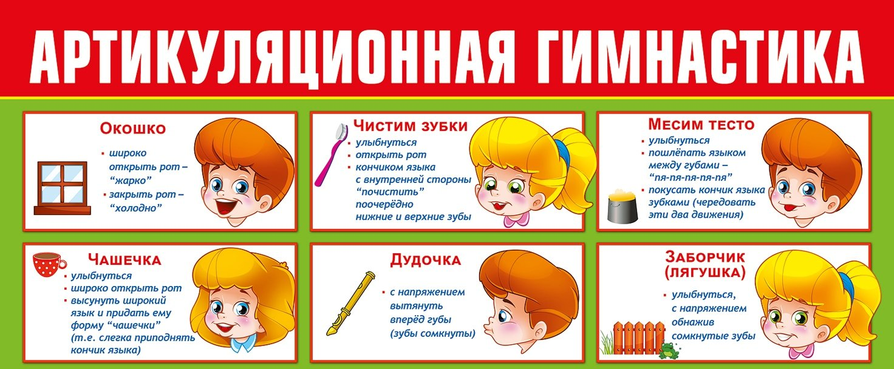
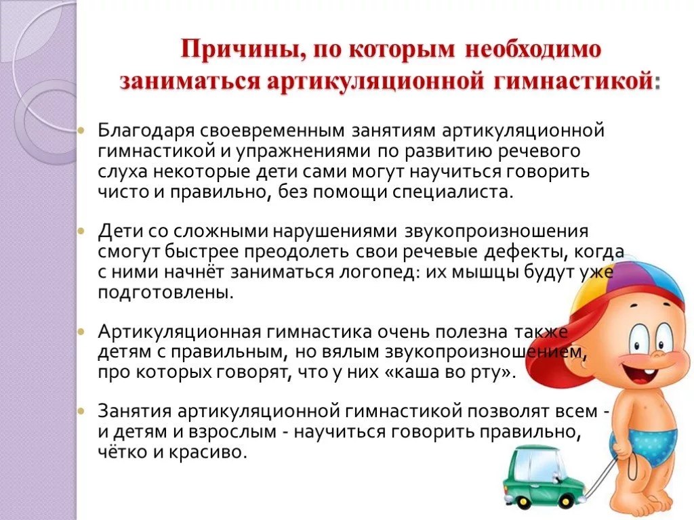

<!-- Источник: input/Соколова О.В.__Артикуляционная гимнастика.docx -->

# Артикуляционная гимнастика

Для правильного звукопроизношения необходимо, чтобы артикуляционный аппарат ребенка – язык, губы, челюсти – работал правильно и четко. Работа по развитию основных движений органов артикуляционного аппарата проводится в форме артикуляционной гимнастики.

Цель артикуляционной гимнастики: выработка полноценных движений и определенных положений органов артикуляционного аппарата, необходимых для правильного произношения звуков. Проводить артикуляционную гимнастику нужно ежедневно, чтобы вырабатываемые у детей навыки закреплялись.

## Черновое распознавание текста на изображениях

> Автоматическое распознавание Windows OCR. Возможны ошибки в словах и порядке строк. При сверке используйте изображения выше; этот раздел не является проверенным текстом автора.

### image-001.jpg

АРТИКУЛЯЦИОННАЯ гимпстип  
Окошко  
• широко  
открыть рот —  
“жарко  
• закрыть рот —  
”холодно ”  
ЧАШЕЧКА  
• улыбнуться  
• широко открыть рот  
• высунуть широкий  
язык и придать ему  
форму ”чашечки"  
(т.е. слегка приподнять  
кончик языка)  
ЧИСТИМ ЗУБКИ  
• улыбнуться  
• открыть рот  
• кончиком языка  
с внутренней стороны  
“ почистить ”  
поочерёдно  
нижние и верхние зубы  
ДУДОЧКА  
• с напряжением  
вытянуть  
вперёД губы  
(зубы сомкнуты)  
МЕСИМ ТЕСТО  
• улыбнуться  
• пошлёпать языком  
между губами —  
• покусать кончик языка  
зубками (череДовать  
эти два Движения)  
ЗАБОРЧИК  
(ЛЯГУШКА)  
• улыбнуться,  
с напряжением  
обнажив  
сомкнутые зубы

### image-002.png

Причины, по которым необходимо  
заниматься артикуляционной гимнастикой:  
Благодаря своевременным занятиям артикуляционной  
гимнастикой и упражнениями по развитию речевого  
слуха некоторые дети сами могут научиться говорить  
чисто и правильно, без помощи специалиста.  
Дети со сложными нарушениями звукопроизношения  
смогут быстрее преодолеть свои речевые дефекты, когда  
с ними начнёт заниматься логопед: их мышцы будут уж  
подготовлены.  
Артикуляционная гимнастика очень полезна та  
детям с правильным, но вялым звукопроизнош  
про которых говорят, что у них «каша во рту».  
м,  
Занятия артикуляционной гимнастикой позволят всем -  
и детям и взрослым - научиться говорить правильно,  
чётко и красиво.
