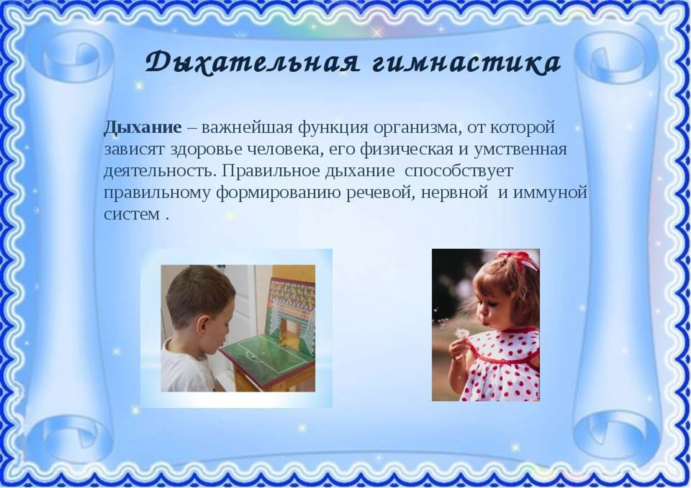
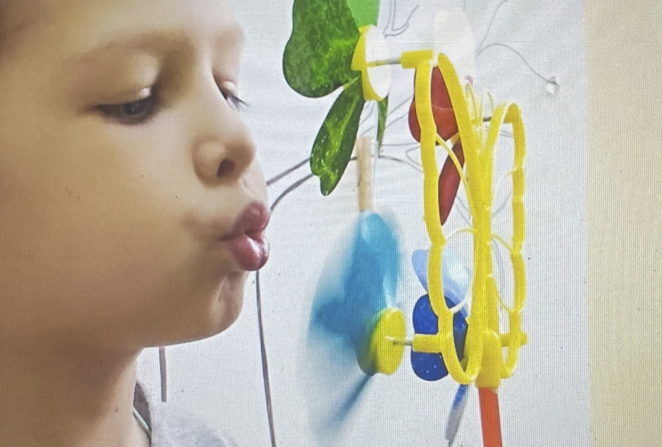
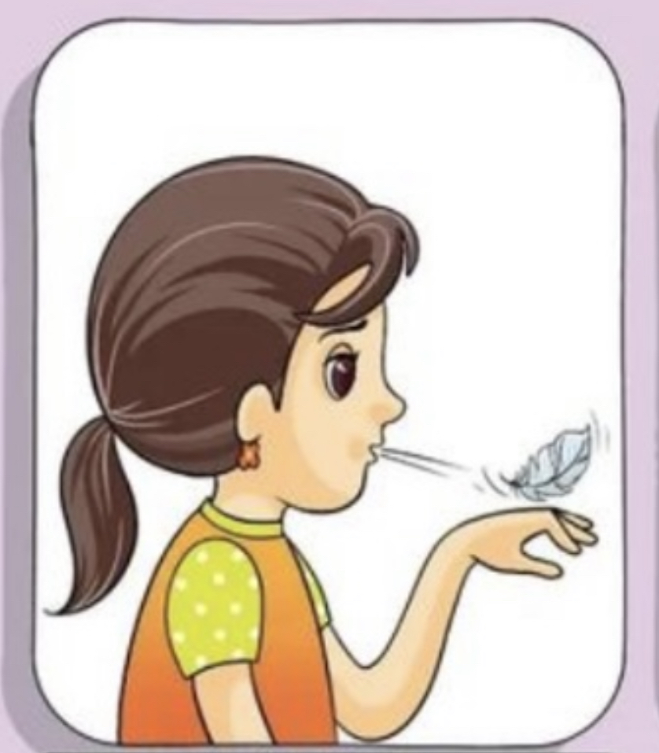
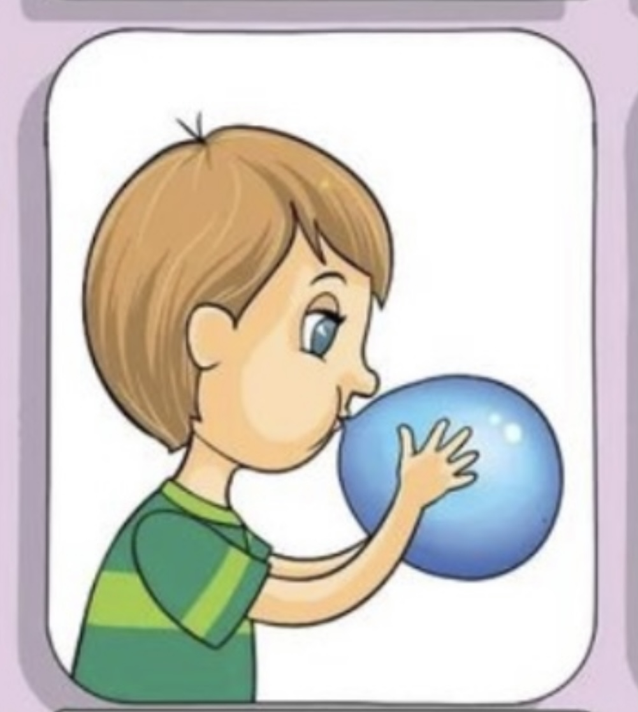
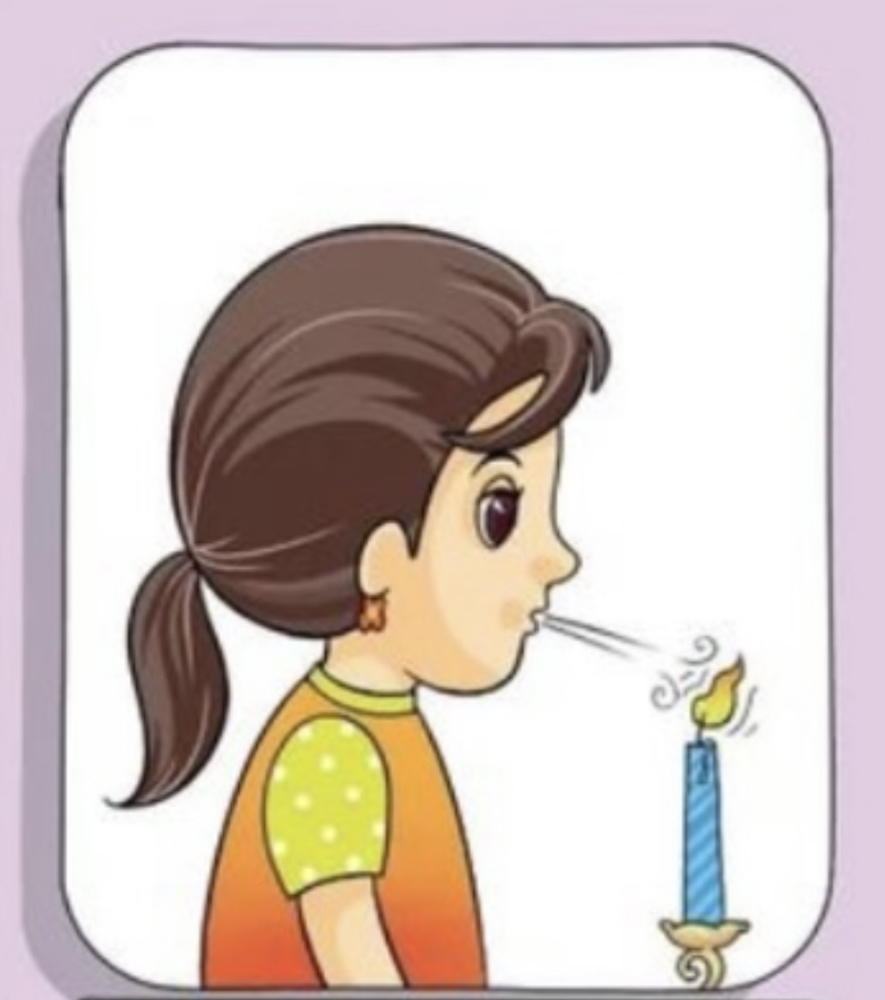
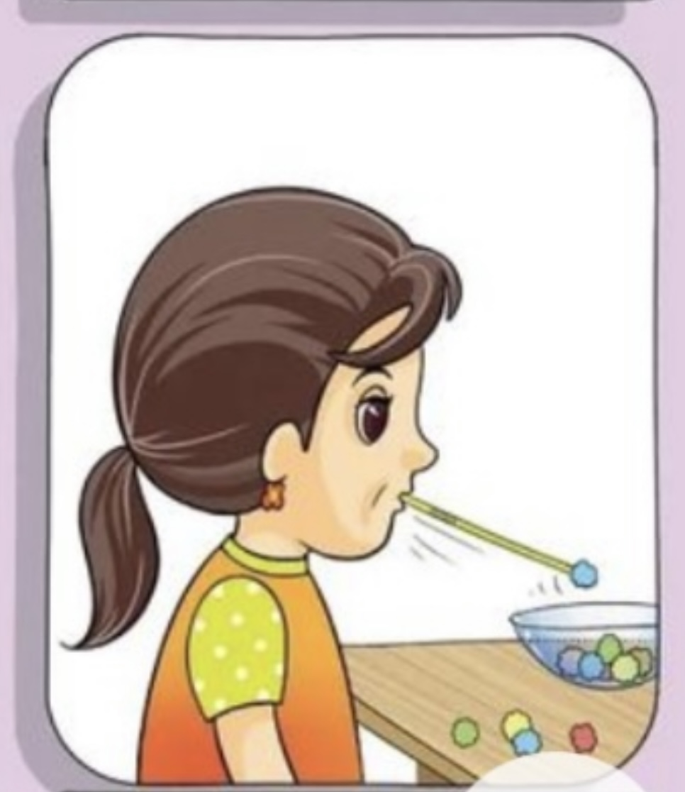
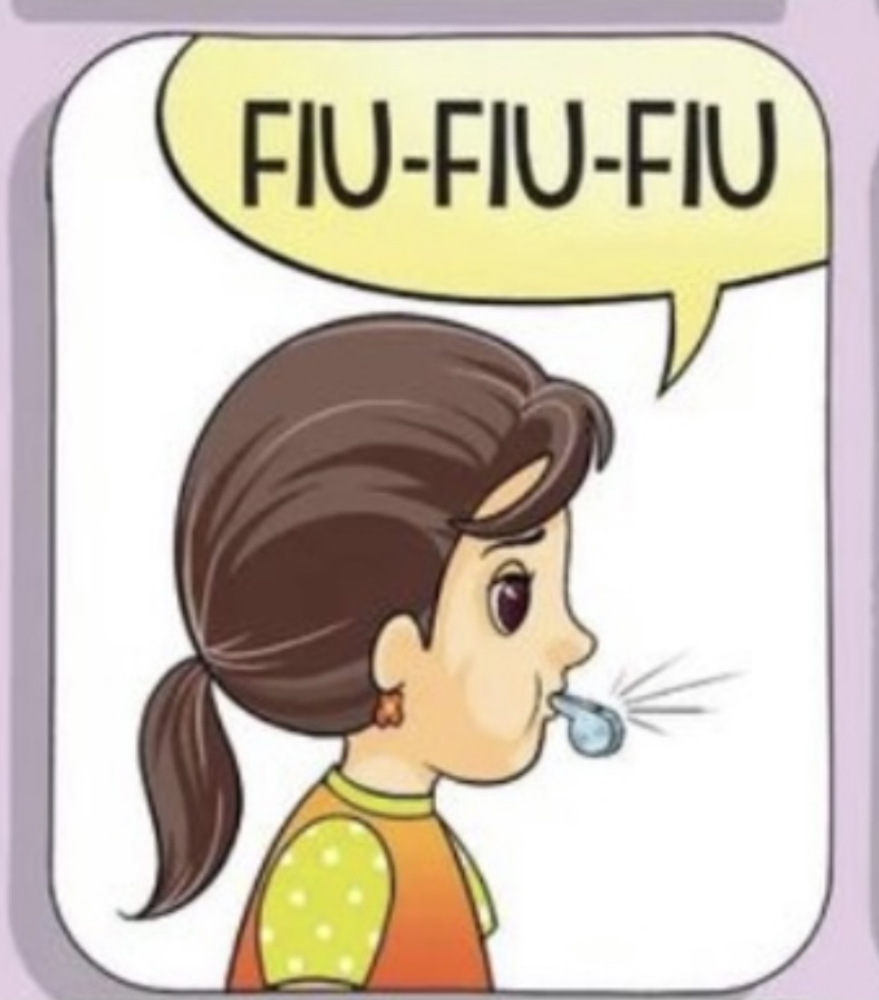
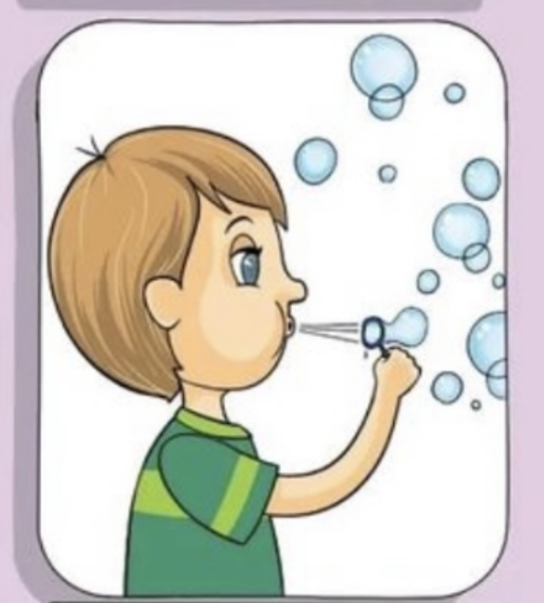
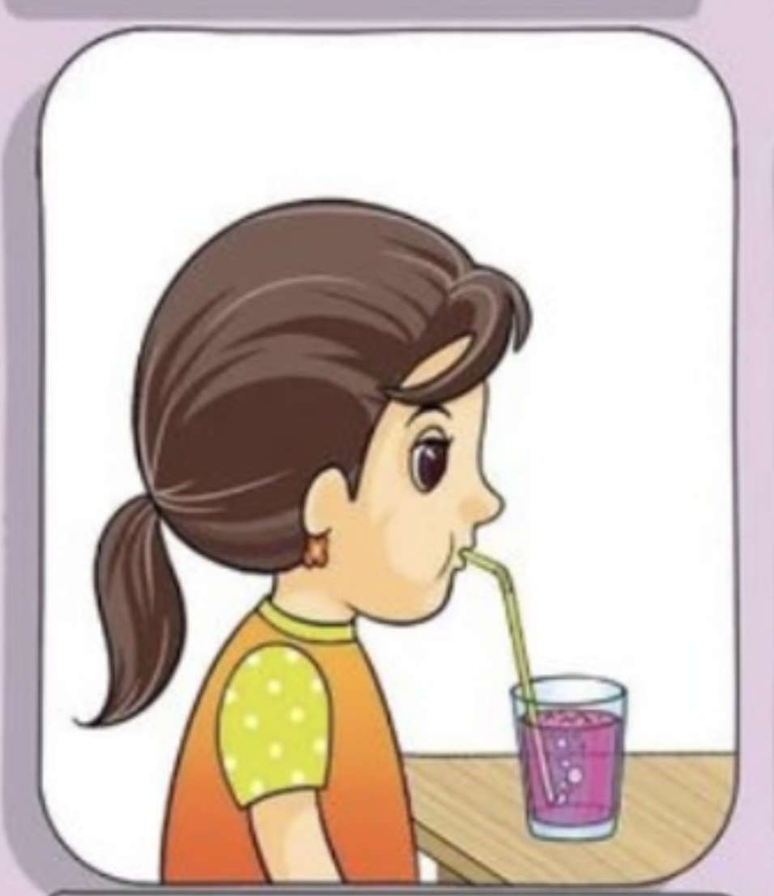
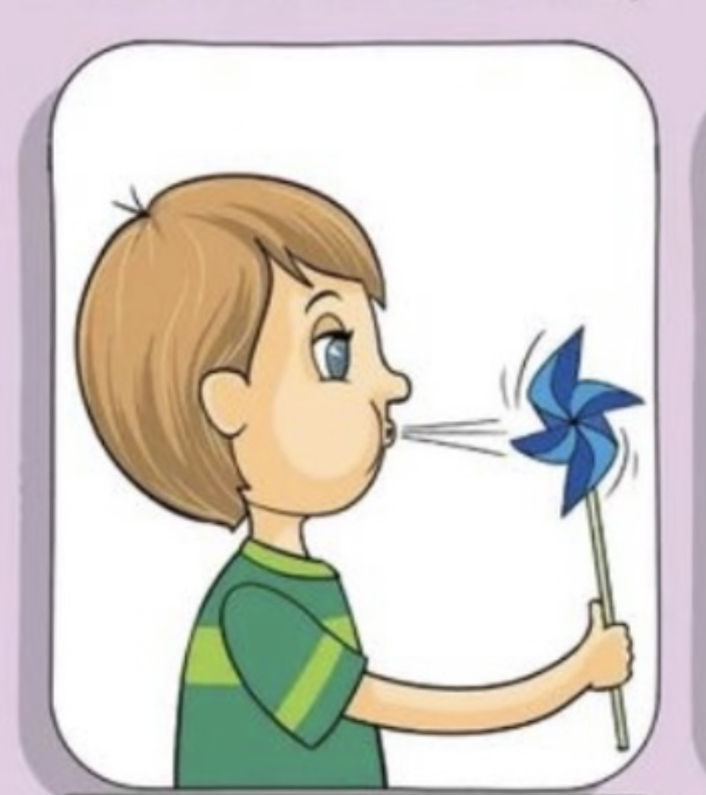

<!-- Источник: input/Соколова О.В.__Дых гимн.docx -->

# Дыхательная гимнастика

**_Дыхательная гимнастика_** _– это комплекс дыхательных упражнений, способствующий развитию речевого дыхания. Дыхательная и артикуляционная гимнастики являются важнейшими компонентами в структуре логокоррекционных занятий с дошкольниками, имеющими дефекты звукопроизношения._

_Дома родители могут заниматься дыхательной гимнастикой в игровой форме, используя обычные предметы: мыльные пузыри, вертушки, свечки, свистки и детские музыкальные инструменты, пёрышки и легкие предметы, трубочка в стакане с водой, воздушные шарики и т.д._

  

  

 

## Черновое распознавание текста на изображениях

> Автоматическое распознавание Windows OCR. Возможны ошибки в словах и порядке строк. При сверке используйте изображения выше; этот раздел не является проверенным текстом автора.

### image-001.png

тыкателъная гимнастикр  
Дыхание — важнейшая функция организма, от которой  
зависят здоровье человека, его физическая и умственная  
деятельность. Правильное дыхание способствует  
правильному формированию речевой, нервной и иммуной  
систем .
