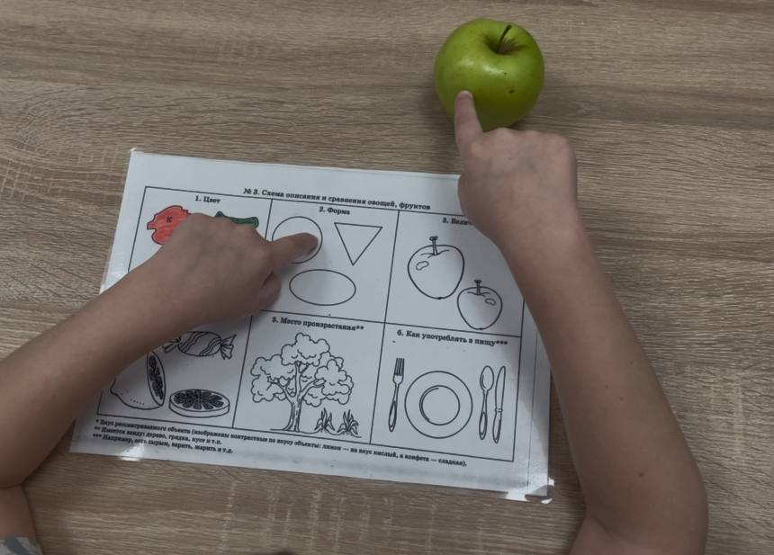
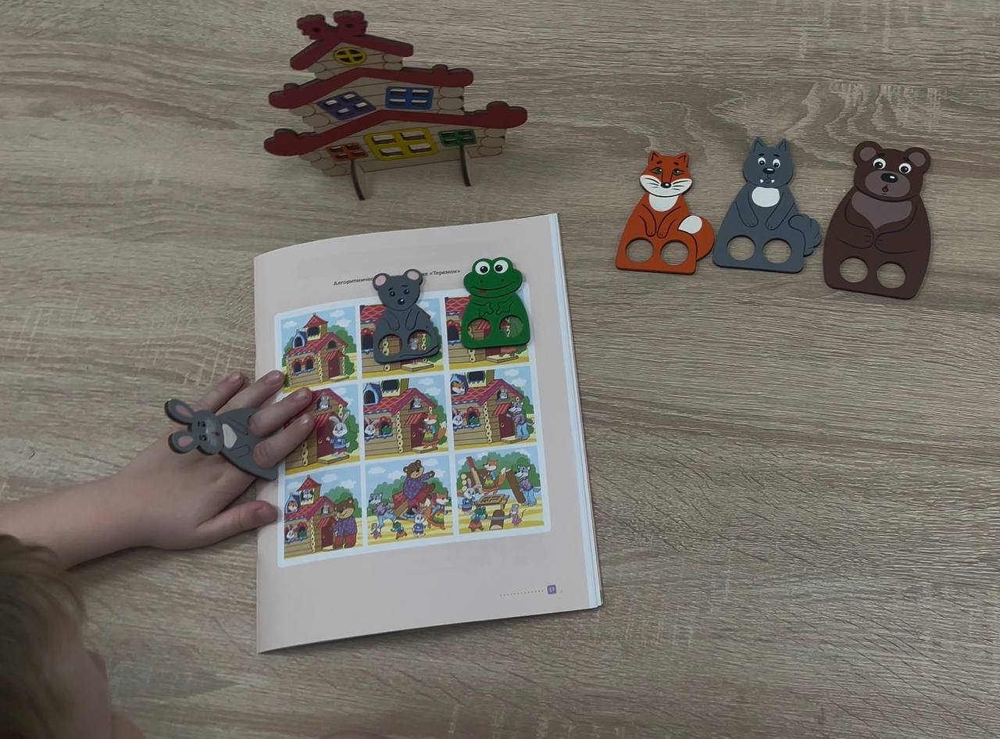
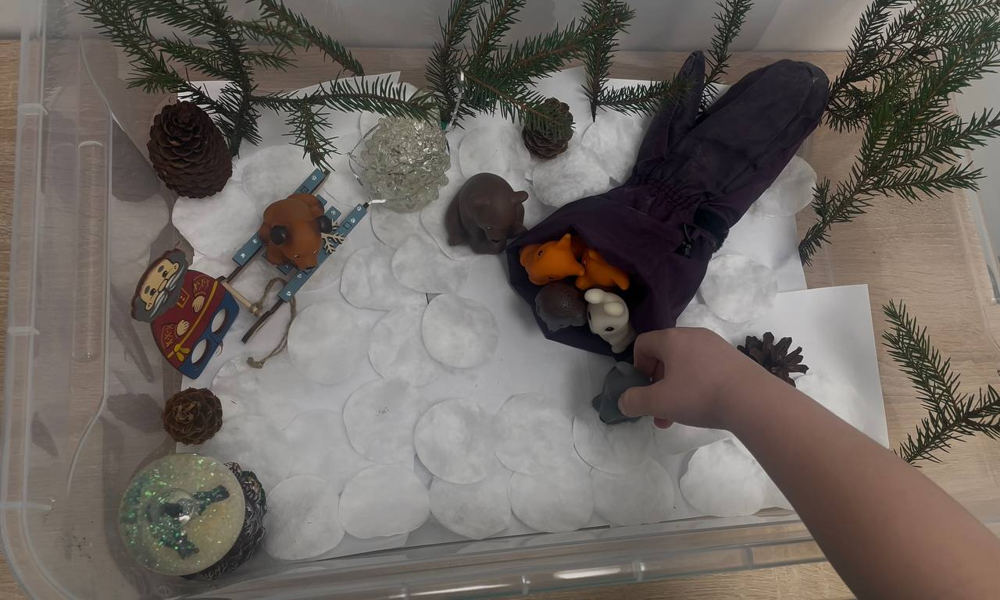
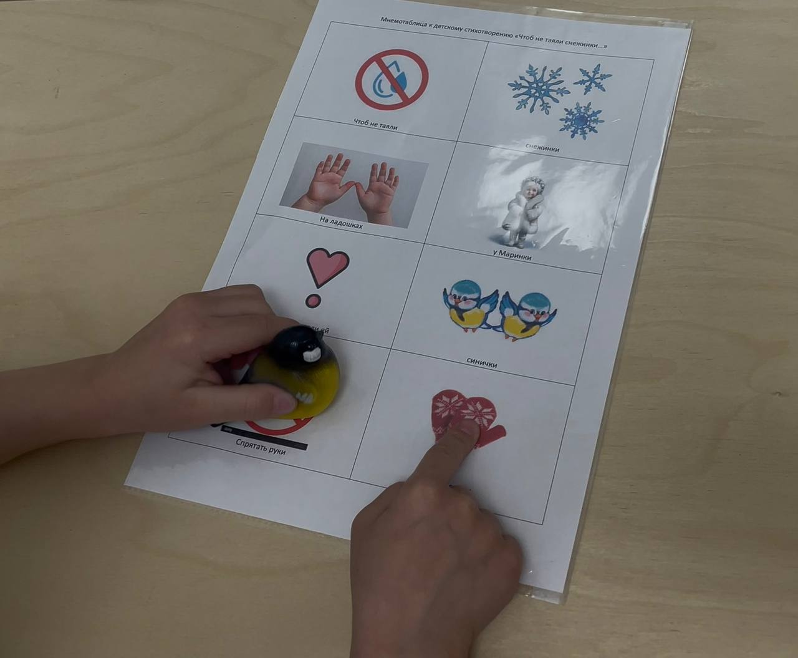

<!-- Источник: input/Соколова О.В._Развитие связной речи у дошкольников с общим недоразвитием речи в мультиметодическом подходе на логопедических занятиях_.docx -->

# Развитие связной речи в мультиметодическом подходе

**Развитие связной речи у дошкольников с общим недоразвитием речи**

**в мультиметодическом подходе на логопедических занятиях**

Согласно ФГОС ДО одной из задач реализации области «Речевое развитие» является «развитие связной, грамматически правильной диалогической и монологической речи» \[7\]. Во многом именно уровень развития связной речи у дошкольников с ОНР определяет их дальнейший образовательный маршрут, общую успеваемость в школе, формирование личностных качеств и успешность социализации. Все это объясняет высокую актуальность проблемы, ее широкую представленность в практической работе учителей-логопедов и поиск новых методических приемов, реализуемых на логопедических занятиях в ДОУ.

По определению В.К. Воробьевой связная речь – это «вид речемыслительной деятельности, результатом которой является текстовое сообщение. Как продукт речемыслительной деятельности текстовое сообщение выступает в единстве двух планов — внутреннего, предметно-смыслового, и внешнего, формально-языкового» \[1, стр. 9\]. Именно поэтому при выборе форм и методов логопедической работы необходимо учитывать уровень развития и речи, и мышления. У дошкольников с ОНР как правило имеется коморбидность нарушений, которая сказывается на инертности многих психических процессов, в том числе и на развитии всех компонентов речи: у этих детей плохо и долго усваивается лексика и грамматические категории, нарушены фонетико-фонематические процессы, часты различные искажения в слоговой структуре слова, страдает просодическая сторона речи, и все эти речевые дефициты сказываются на связной речи детей.

Ученые, педагоги и методисты, изучающие связную речь у дошкольников с ОНР, отмечают следующие её особенности \[1, 2, 3, 5, 10\]: недостаточное осмысление и осознание содержательной стороны материала и неумение строить программу будущего сообщения; сложности в определении логической последовательности изложения; пересказ сводится к перечислению предметов или действий; пропуск существенных для содержания сообщения моментов; речь таких детей аграмматична, при построении связного высказывания усугубляются трудности лексического характера; многочисленные повторы одного и того же слова (чаще всего подлежащего); трудности в подборе глагольных слов, служащих в предложении выразителями предикативных, смысловых отношений; используются преимущественно простые предложения; нарушение порядка слов в предложении, незаконченность и неразвернутость предложений. Содержание коррекционной работы и выбор методов, которые наиболее эффективно будут влиять на развитие связной речи дошкольников с ОНР, должны учитывать вышеперечисленную специфику.

Выстраивая индивидуальный коррекционный маршрут для дошкольников с ОНР учителю-логопеду необходимо учитывать следующие направления работы по развитию связной речи, которые предлагает Т.Б. Филичева: «обогащение словарного запаса; обучение составлению пересказа и придумыванию рассказов; разучивание стихотворений; отгадывание загадок» \[3, стр. 209\]. Логопедическая работа по развитию связной речи окажется результативной, если по всем вышеперечисленным направлениям будет проводиться целенаправленная и систематическая работа с использованием комплекса методов и приемов, учитывающего уровень развития речи и индивидуальные особенности дошкольников с ОНР.

**_Обогащение словарного запаса_**

Обогащение словарного запаса — важная составляющая логопедической работы, направленная на развитие активного и пассивного словаря ребенка. Цель обогащения словарного запаса заключается в расширении объема употребляемых ребенком слов, совершенствовании грамматического строя речи и развитии связной речи. При изучении новой лексики на логопедических занятиях с дошкольниками с ОНР необходимо следовать общепедагогическому принципу наглядности и использовать наглядные методы, которые благодаря визуальному подкреплению помогают детям лучше воспринимать и запоминать новую лексику.

С дошкольниками II – III уровней речевого развития в качестве такого метода могут быть использованы различные фразовые конструкторы, благодаря которым дети обогащают свой словарный запас и учатся составлять и использовать в активной речи простые и сложные предложения. При подборе речевого материала необходимо учитывать как звукопроизносительные возможности, так и уровень развития слоговой структуры слова ребенка.

Для закрепления изученной лексики можно применять метод составления описательного рассказа при помощи схем, например, использовать схемы из пособия известного логопеда-практика Т.А. Ткаченко \[8\].

_Составление описательного рассказа по схеме Т.А. Ткаченко_

_по лексической теме «Фрукты»_

Обогащение словарного запаса и развитие связной речи с помощью метода схем осуществляется на уровне усвоения детьми номинативного, предикативного и атрибутивного словарей.

**_Обучение составлению пересказа и придумыванию рассказов_**

Обучение составлению пересказа и придумыванию коротких рассказов и сказок занимает большое место в системе коррекционной работы и ведется с учетом уровня речевого развития дошкольников.

Работая с детьми с ОНР, соответствующими I - II уровню речевого развития, можно использовать метод сказкотерапии, поскольку язык сказок характеризуется доступной лексикой, несложными грамматическими формами, наличием определений и простыми образцами прямой речи \[5, 6\]. Профессор Н.Н. Трауготт писала: «Первое, чему должен научить неговорящего ребенка учитель, это слушать и понимать рассказы и сказки, соответствующие его развитию и интересам» \[9, стр. 19\]. В этой работе учителю-логопеду могут помочь воспитатели дошкольного учреждения, которые знакомят детей со сказками на занятиях по чтению художественной литературы, а также родители воспитанников, читающие своим детям сказки дома. Такие совместные усилия всех субъектов коррекционно-развивающего процесса (учителя-логопеда, педагогов ДОУ и родителей воспитанников) сказываются на высокой динамике коррекции.

В своей работе учителя-логопеды широко используют метод алгоритмических схем и опорных картинок для обучения детей III - IV уровней речевого развития составлению описательных и сравнительных рассказов. В начальном периоде обучения пересказу коротких рассказов и сказок логопед читает текст, а затем проводит беседу о главных героях, об их действиях и о последовательности событий. Также педагог работает над лексико-грамматическим строем: помогает ребенку с подбором слов, исправляет аграмматизмы, объясняет непонятные слова. Далее ребенок пересказывает рассказ или сказку по наводящим вопросам педагога, выкладывая на плоскость алгоритмических схем или опорных картинок игрушки или плоскостные фигурки героев.

_Пересказ сказки «Теремок» по алгоритмической схеме Н.В. Нищевой_

_с элементами театрализации (пальчиковый театр)_

Другой метод, который можно использовать на логопедических занятиях по развитию связной речи с дошкольниками с ОНР, – пересказ и придумывание коротких рассказов и сказок с помощью театрализации. Это может быть театр пальчиковый, кукольный, фигурный, магнитный, фетровый, театр на фланелеграфе, театр с использованием дидактического пособия «Фартук сказок».

В качестве модификации кукольного театрального пересказа можно использовать любимую многими дошкольниками «сенсорную коробку», в которой происходит действие рассказа или сказки с использованием кукол, игрушек и различного сенсорного материала.

_Пересказ сказки «Рукавичка» с элементами театрализации_

_с использованием «сенсорной коробки»_

В процессе обучения пересказу и придумыванию рассказов и сказок дошкольники с ОНР воспроизводят их в собственной речи, тем самым совершенствуя лексико-грамматический строй, улучшая понимание обращенной речи, дошкольники научаются построению простых и сложных предложений, стимулируют инициативу к коммуникации, развивают интерес к чтению и слушанию литературных произведений.

**_Разучивание стихотворений_**

Разучивание стихов - один из действенных приемов развития связной речи дошкольников с общим недоразвитием речи \[3, 10\]. Педагоги используют различные методы заучивания стихов - использование игровых приемов, таких как "доскажи словечко", заучивание стихов в движении, но один из любимых и эффективных методов – это заучивания стихов с помощью визуализаций, иллюстраций или мнемотаблиц. Этот метод помогает детям запомнить сюжет, порядок действий, героев и предметы, описываемые в стихотворении.

_Заучивание стихотворения «Чтоб не таяли снежинки…»_

_с помощью авторской мнемотаблицы_

Данный метод активизирует речь детей, обогащает словарный запас, дает детям образец грамматически правильно построенных предложений, дошкольники научаются в самостоятельной речи использовать лексику и грамматические обороты из стихотворений.

**_Отгадывание загадок_**

«Загадка – это краткое описание предмета или явления, часто в поэтической форме, заключающее в себе замысловатую задачу в виде явного (прямого) или предполагаемого (скрытого) вопроса» \[4, стр. 9\]. Загадки обогащают словарь, помогают усвоить грамматический строй речи, развивают речемыслительную деятельность и в целом связную речь. Загадки бывают разные: по форме и стилю, рифмованные, описательные, литературные, текстовые, с переносным значением слов и выражений и т.д. При загадывании загадок ребенку надо учитывать как степень трудности и характер умственной операции, которую предстоит совершить ребенку, так и сложность художественного образа и особенности речевой формы загадки.

В методиках развития речи дошкольников с ОНР в качестве метода, облегчающего работу с загадками на начальных этапах обучения, предлагают подсказывающие опорные картинки, затем – загадки с рифмованными отгадками в последнем предложении \[4, 10\]. Такая загадка структурно не окончена: ее незавершенность связана с синтаксическим и ритмическим оформлением, с пропуском рифмы, и при правильном назывании слова-отгадки образуется ритмическая завершенность:

_Тучек нет на горизонте,_

_Но раскрылся в небе зонтик._

_Через несколько минут_

_Опустился... (Парашют)._

На более продвинутом уровне развития речи и мышления дошкольникам можно задавать загадки-обманки, правильный ответ которых не подчиняется рифме стихотворной загадки:

_Люблю кататься я на льду._

_Ура! Зима всё ближе!_

_С друзьями на каток пойду_

_И там надену… лыжи? (нет, Коньки)._

Коррекционные возможности загадки многообразны. Эпитеты, метафоры и сравнения, часто используемые в загадках, прививают детям чувство красоты, образности и выразительности русского языка:

_Сам алый, сахарный,_

_Кафтан зеленый, бархатный (Арбуз)._

Загадка, несмотря на миниатюрность своей формы, обладает многими ценными характеристиками, необходимыми в коррекционной работе с дошкольниками с недоразвитием речи: формирует любовь к народному творчеству, русскому языку, образному и точному слову, развивает языковые представления о возможностях переносного употребления слова, содействует пониманию значения той или иной морфемы, развивает его мыслительные способности и, конечно, совершенствует языковую подготовку ребенка. Ю.Г. Илларионова отмечает: «Загадка, будучи описанием, заключает в себе много возможностей для обогащения словаря детей новыми словами, словосочетаниями, образными выражениями, а также для развития у детей навыков описательной речи» \[4, стр. 74\]. Таким образом, роль загадок велика, они оказывают большое влияние на обогащение словарного запаса и на развитие связной речи дошкольников.

**_Выводы_**

Комплексная, целенаправленная и систематическая работа над развитием связной речи с использованием комплекса разнообразных методов на логопедических занятиях с дошкольниками с общим недоразвитием речи обогащает словарный запас, формирует умение пересказа и придумывания коротких рассказов и сказок, заучивания стихотворений и отгадывания загадок. Таким образом создаются условия для полноценного овладения детьми речью как средством общения, формируются коммуникативные способности детей, развиваются способности самостоятельно выражать мысли и чувства, строить грамматически правильные высказывания и вести диалог, способствуя успешному социальному взаимодействию и подготовке к школьному обучению. Логопедическая работа по развитию связной речи дошкольников с общим недоразвитием речи в представленном мультиметодическом подходе высокоэффективна и успешна.

**_Список литературы_**

1.  Воробьева В.К. Методика развития связной речи у детей с системным недоразвитием речи: учеб. пособие / В.К. Воробьева — М.: ACT: Астрель: Транзиткнига, 2006 — 158 с.
2.  Глухов В.П. Комплексный подход к формированию связной речи у детей дошкольного возраста с нарушениями речевого и познавательного развития: Монография. – М.: В. Секачев, 2014 – 537 с.
3.  Жукова Н.С., Мастюкова Е.М., Филичева Т.Б. Логопедия: основы теории и практики. Система логопедического воздействия – Москва, ЭКСМО, 2020 – 288 с.
4.  Илларионова Ю. Г. «Учите детей отгадывать загадки» - М.: Просвещение, 1976 – 127с.
5.  Нищева Н.В. Алгоритмические схемы для рассказывания сказок (3-8 лет) - Издательство: ДЕТСТВО-ПРЕСС, 2025 – 32 с.
6.  Политыкина А.А., Васькова О.Ф. Сказкотерапия как средство развития речи детей дошкольного возраста - Издательство: ДЕТСТВО-ПРЕСС, 2021 – 112 с.
7.  Приказ Министерства образования и науки РФ от 17 октября 2013 г. N 1155 «Об утверждении федерального государственного образовательного стандарта дошкольного образования» - URL: [https://fgos.ru/fgos/fgos-do/](https://fgos.ru/fgos/fgos-do/)
8.  Ткаченко Т.А. Схемы для составления дошкольниками описательных и сравнительных рассказов. Приложение к пособиям «Учим говорить правильно» – М.: Изд. ГНОМ и Д, 2001 – 16 с.
9.  Трауготт Н.Н. К вопросу об организации и методике речевой работы с моторными алаликами // Хрестоматия по логопедии (извлечения и тек­сты): В 2 тт., Т. II / Под ред. Л. С. Волковой и В. И. Селиверстова — М.: ВЛАДОС, 1997 - 656 с. - С. 3-22
10.  Филичева Т.Б., Туманова Т.В., Соболева А.В. Развиваем речь и мышление дошкольника. Программно-методические указания и вариативные конспекты занятий – М.: В. Секачев, 2018 – 228 с.
