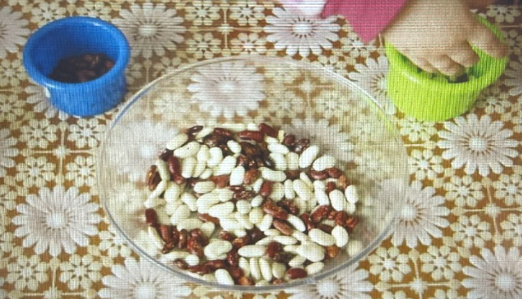
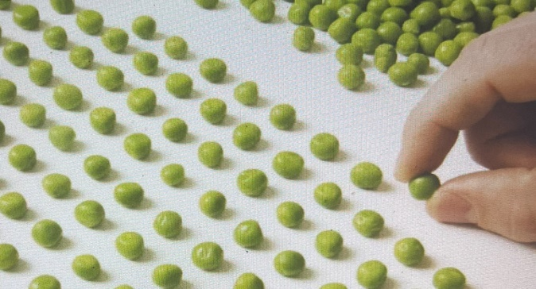
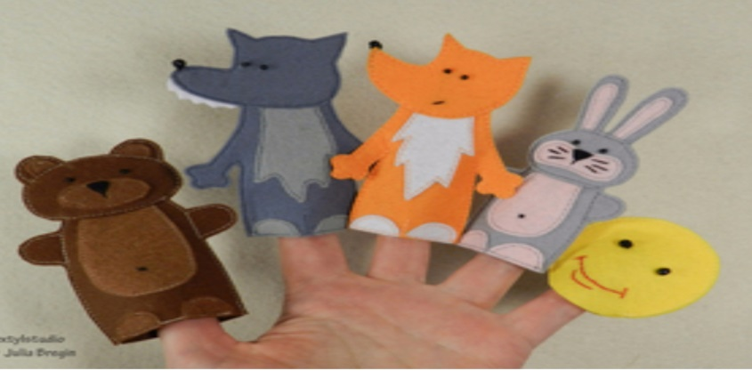

<!-- Источник: input/Соколова О.В._Пальчиковые игры.docx -->

# Пальчиковые игры

**Пальчиковые игры и упражнения**

**как средство развития речи у дошкольников**

_«Ум ребенка находится на кончиках его пальцев»_

_В. А. Сухомлинский_

Пальчиковые игры и упражнения – это чрезвычайно полезное занятие для дошкольников. Они способствуют:

-   развитию мелкой моторики пальцев рук;
-   развитию общей координации движений;
-   подготовке руки к письму;
-   расширению словарного запаса, в целом развитию речи;
-   развитию внимания, памяти, воображения;
-   снятию эмоционального и умственного напряжения;
-   установлению тёплого телесного контакта между ребенком и взрослым.

**Варианты пальчиковых игр и упражнений**

**Игры-манипуляции и сюжетные пальчиковые упражнения** «Ладушки-ладушки…», «Сорока-белобока…», «Пальчик-мальчик, где ты был?..», «Мы делили апельсин…», «Этот пальчик - дедушка…», «Раз, два, три, четыре, кто живет в моей квартире?...», «Пальчики пошли гулять…», «Распускается цветок…» и др. \[1\]

**Пальчиковые кинезиологические упражнения** с использованием нестандарного оборудования (мячики, мягкие бигуди, бусы, карандаши, счетные палочки, платочки, прищепки и проч.) с ритмичным речевым сопровождением. \[2\]

**Игры с крупами** «Золушка» (разбирать отдельно разные крупы), «Дорожка» (выкладывать из различных круп дорожки, фигуры по контуру или шаблону).

 

**Пальчиковые упражнения в сочетании с самомассажем кистей и пальцев рук** \- это традиционные для массажа движения - разминание, растирание, надавливание, пощипывание: «Помоем руки под горячей струей воды», «Гуси щиплют травку» и т.д. Для более эффективного самомассажа кисти рук используются грецкий орех, каштан, шестигранный карандаш, массажный мячик, су-джок.

**Пальчиковый театр** развивает не только мелкую моторику, но и речь, воображение, внимание, слухоречевую память, снимает психоэмоциональное напряжение.

_\_\_\_\_\_\_\_\_\_\_\_\__

_Литература:_

1.  _Крупенчук О.И. Пальчиковые игры для детей 4-7 лет – М.: Литера, 2015_
2.  _Зажигина О.А. Игры для развития мелкой моторики рук с использованием нестандартного оборудования – СПб: Детство-Пресс, 2013_
