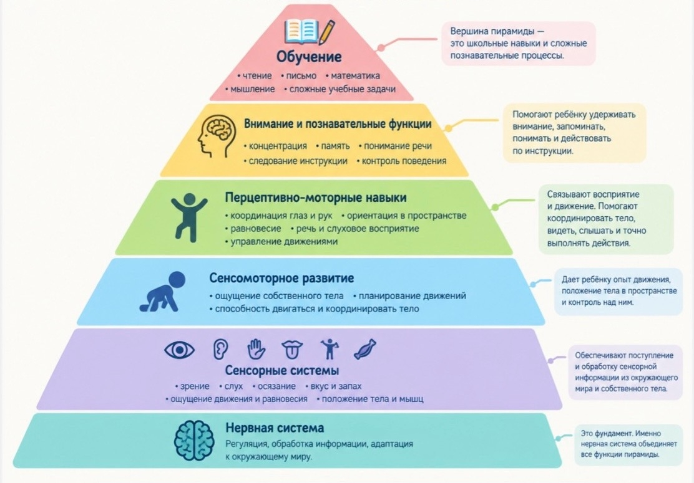

<!-- Источник: input/Соколова О.В._Пирамида обучения Вильямса и Шеленбергера..._.docx -->

# Пирамида обучения Вильямса и Шеленбергера

**Пирамида обучения Вильямса и Шеленбергера.**

**Как базовые функции и навыки влияют на обучение и развитие ребенка.**

(Консультация для родителей. Материалы для «Уголка логопеда» в ДОУ)

Автор:

Соколова Ольга Владимировна

учитель-логопед 1 квалификационной категории

(МБОУ для обучающихся с OB3 Старогородковская ОШ «Гармония».

Дошкольное отделение: Детский сад Nº 40)

**Пирамида обучения Вильямса и Шеленбергера -** это наглядная схема процессов психического созревания ребенка. Она иллюстрирует, насколько все обучение ребенка, его интеллект, поведение, речь, зависит от нижних «этажей» пирамиды, и особенно от фундамента - нервной системы. Не обеспечив развитие ребенка на нижних «этажах», мы не можем требовать формирования навыка, который находится на более высоких «этажах» пирамиды.

_Пирамида обучения Вильямса и Шеленбергера_

Только тогда, когда у ребенка правильно функционируют сенсорные системы, когда развиты координационные способности и физические качества и навыки, только тогда он сможет контролировать свои эмоции и поведение, быть уверенным в управлении своими движениями и быть успешным в социально-бытовой ориентировке, а также воспринимать информацию на слух и коммуницировать. Эта наглядная модель, которая помогает понять важную вещь: ребенку бывает трудно учиться, говорить, концентрироваться или управлять поведением не потому, что он “ленится” или “не старается”, а потому что какая-то более базовая функция ещё недостаточно сформирована.

Представьте дом. У дома есть фундамент, стены и верхние этажи. Нельзя бесконечно надстраивать верхний этаж, если фундамент плохо построен. С развитием ребенка похожая логика: сложные навыки опираются на более простые.

**Пример с недоразвитием речи**

Если у ребенка плохое речевое развитие, то естественная реакция — заниматься речью. И педагогические занятия действительно необходимы. Однако, пирамида напоминает: речь - сложный навык, который находится далеко не в основании пирамиды. Поэтому специалист может обратить внимание также на слуховое восприятие, сенсорный и двигательный опыт, координацию, другие базовые функции и, конечно, на работу центральной нервной системы. 

**А что это дает родителям?**

Самое полезное - это перестать смотреть только на проблему на верхнем «этаже». Например, ребенок не хочет делать домашнее задание. Первая мысль родителя: «Он невнимательный. Надо заставить его больше концентрироваться». А можно посмотреть через пирамиду: выспался ли он? → не перегружен ли? → достаточно ли двигался? → удобно ли ему сидеть? → хорошо ли он видит и слышит? → понимает ли инструкцию? → может ли удерживать внимание? → есть ли клинические проявления нарушения работы нервной системы? _(на этот вопрос поможет ответить врач)_ → и только потом - само обучение. То есть вместо бесконечного: «Сядь! Сосредоточься! Перестань баловаться! Не отвлекайся!», мы спрашиваем: «Что сейчас мешает ребенку выполнять учебную задачу?». Это совершенно другой взгляд.

Родитель может использовать пирамиду не как программу упражнений, а как способ задавать себе правильные вопросы:

-   **Сначала смотрим на фундамент (**сон, питание, движение, отдых, общее состояние здоровья ребенка). Если ребенок хронически недосыпает, перегружен занятиями и почти не двигается, требовать от него идеальной концентрации в процессе обучения неправильно.
-   **Даем ребенку много разнообразного движения.** Не обязательно покупать специальное оборудование. Полезны обычные вещи: бегать; прыгать; лазать; кататься на велосипеде/самокате; играть с мячом; ходить по разным поверхностям; танцевать; строить препятствия из подушек; играть на детской площадке. Движение - не пустая трата времени между занятиями. Оно является частью сенсомоторного опыта ребенка.
-   **Развиваем тело в обычной жизни.** Пусть ребенок: сам одевается; застёгивает пуговицы; помогает накрывать на стол; лепит; рисует; режет безопасными детскими ножницами; строит из конструктора; помогает по дому - переносит нетяжёлые вещи; помогает готовить. То есть не обязательно превращать всё в «развивающее занятие», можно просто включать ребенка в жизнь и дела семьи.

Необходимо учитывать возможности нервной системы и развития процессов, находящихся на нижних «этажах», а не только наши ожидания от ребенка. Гораздо полезнее воспринимать пирамиду как карту для наблюдения: «Если ребенку трудно на верхнем «этаже», посмотрим, насколько хорошо работают нижние «этажи».

## Черновое распознавание текста на изображениях

> Автоматическое распознавание Windows OCR. Возможны ошибки в словах и порядке строк. При сверке используйте изображения выше; этот раздел не является проверенным текстом автора.

### image-001.jpg

аађ•  
Обучение  
• чтение .лисьмо • математика  
• мышление • сложные учебные задачи  
Внимание и познавательные функции  
Вершина пирамиды —  
это школьные навыки и сложные  
познавательные процессы.  
• концентрация • память • понимание речи  
• следование инструкции • контроль поведения  
Перцептивно-моторные навыки  
• координация глаз и рук • ориентация в пространстве  
• равновесие • речь и слуховое восприятие  
• управление движениями  
Сенсомоторное развитие  
• ощущение собственного тела • планирование движений  
• способность двигаться и координировать тело  
Сенсорные системы  
• зрение • слух • осязание • вкус и запах  
• ощущение движения и равновесия • положение тела и мьшц  
Нервная система  
Регуляция. обработка информации. адаптация  
к окружающему миру,  
Помогают ребёнку удерживать  
внимание, запоминать,  
понимать и действовать  
по инструкции.  
Связывают восприятие  
и движение. Помогают  
координировать тело,  
видеть, слышать и точно  
выполнять действия.  
Дает ребёнку опыт движения  
положенье тела в пространстве  
и контроль ни нин  
ъ.  
Обеспечивают поступление  
и обработку сенсорной  
из окружакпего  
мира и собственного тела  
Это фунда*нт. Именно  
нервная система объединяет  
все функции мрамиды,
