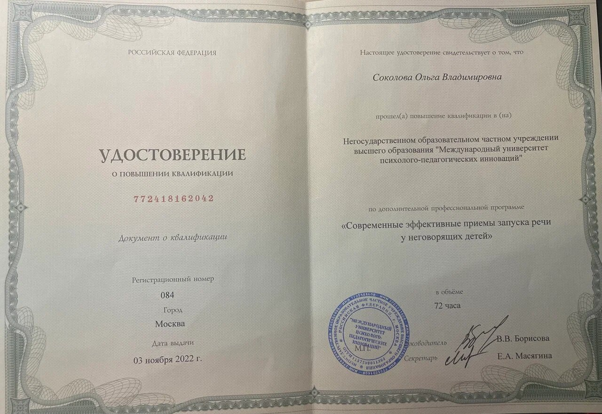
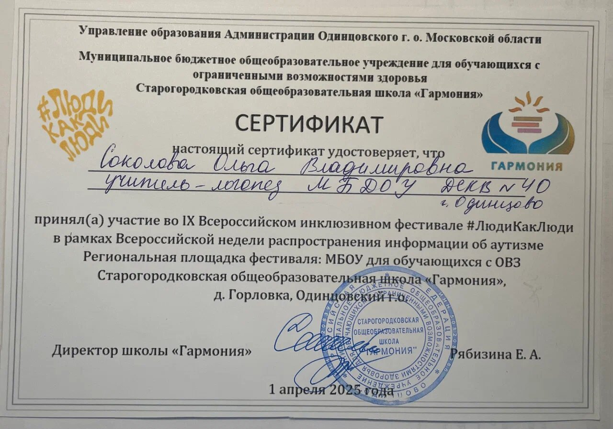
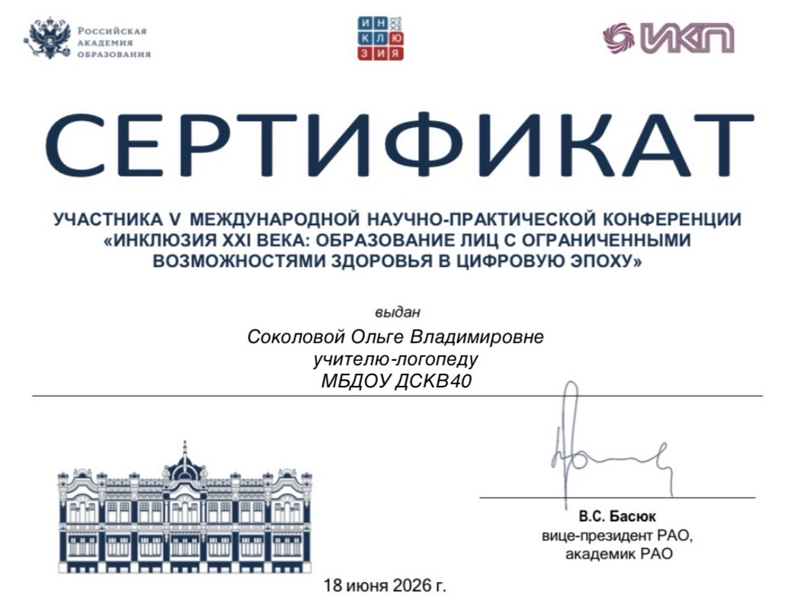
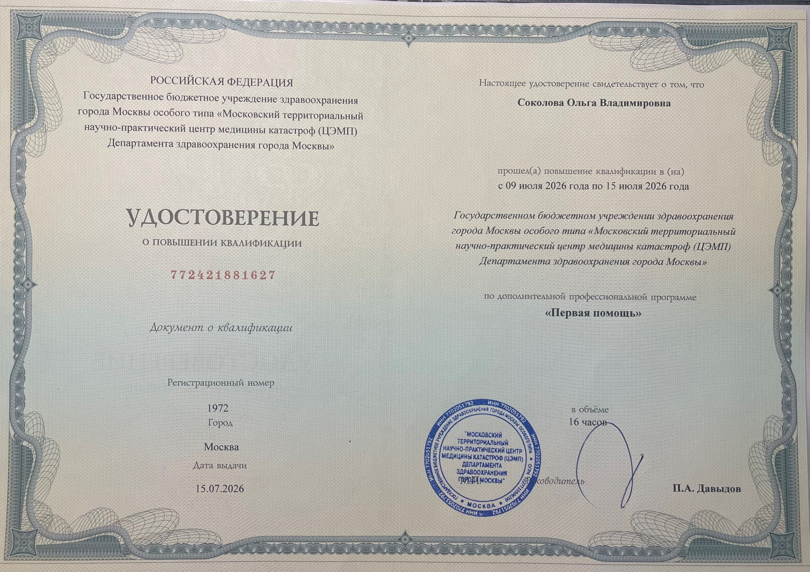
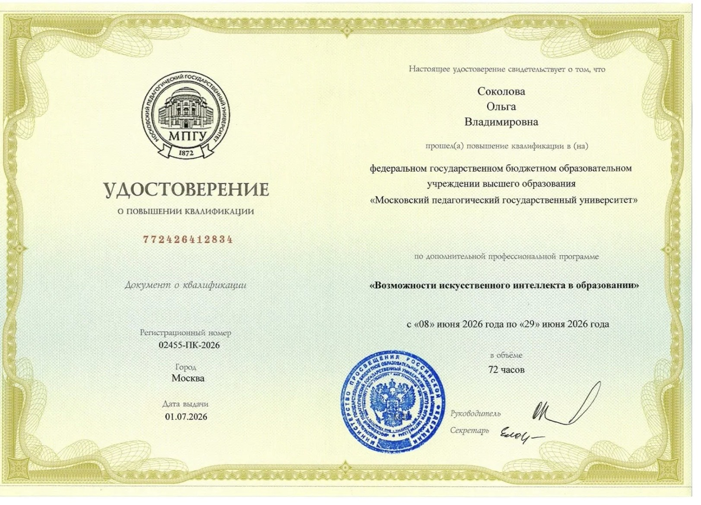
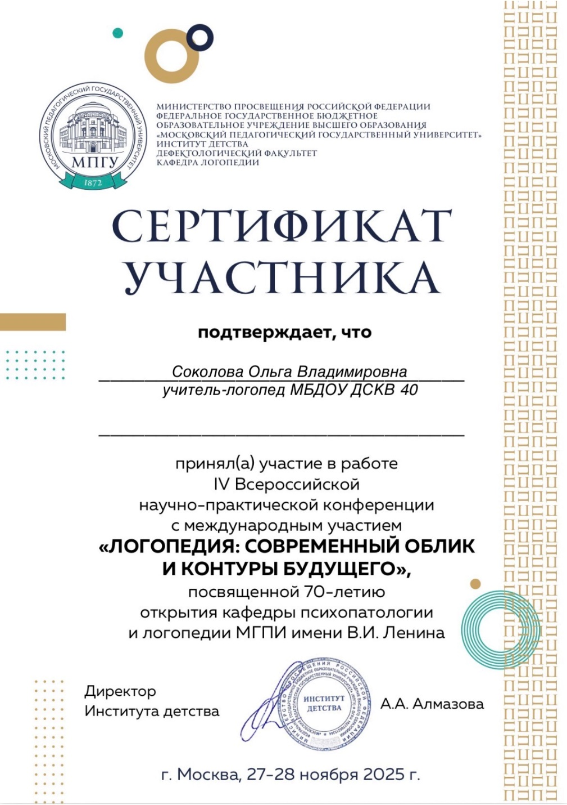

<!-- Источник: input/Соколова О.В._Курсы повышения квалификации.docx -->

# Повышение квалификации

| **№ п/п** | **Тема программы повышения квалификации/ стажировки, вид** (очная, дистанционная) | **Место   прохождения** | **Название** **организации,** **осуществляющей   повышение квалификации** | **Сроки   обучения** | **Название и** **№ документа** (заполняется при завершении обучения) | **Количество часов** |
| --- | --- | --- | --- | --- | --- | --- |
| 1. | «Современные эффективные приемы запуска речи у неговорящих детей», дистанционная | г. Москва | НОЧУ ВО «Международный университет психолого-педагогических инноваций» (Мерсибо) | с 01.09.2022 по 03.11.2022 | Удостоверение № 772418162042, рег № 084 от 03.11.2022 | 72 |
| 2. | «Основы оказания первой помощи», дистанционная | г. Смоленск | ООО «Инфоурок» | с 24.10.2022 по 16.11.2022 | Удостоверение ПК 00437293, рег № 432962 | 72 |
| 3. | «Современные подходы к организации речевого развития детей дошкольного возраста», дистанционно | г. Орехово-Зуево | Государственный образовательное учреждение высшего образования Московской области «Государственный гу-манитарно-технологический университет» | с 28.10.2022 по 21.11.2022 | Удостоверение № 5031 02771692, рег № 2118-ИПК | 18 |
| 4. | «Роль воспитателя в реализации единого ядра содержания дошкольного образования в контексте новой федеральной образовательной программы дошкольного образования 2023», дистанционная | г. Брянск | ООО «Федерация развития образования» | 24.05.2023 | Удостоверение 00000324476 64970, рег.№ 363247664970 | 144 |
| 5. | «Педагогика раннего возраста», дистанционная | г. Орехово-Зуево | Государственный образовательное учреждение высшего образования Московской области «Государственный гу-манитарно-технологический университет» | с10.11.2023 по 30.11.2023 | Удостоверение 5031 03487952, рег № 2914-ИПК от 08.12.2023 | 72 |
| 6. | «Проектная деятельность в дошкольной образовательной организации», дистанционная | г. Орехово-Зуево | Государственный образовательное учреждение высшего образования Московской области «Государственный гу-манитарно-технологический университет» | с 09.11.2023 по 21.12.2023 | Удостоверение 5031 02781043, рег № 3106-ИПК от 22.12.2023 | 72 |
| 7. | «Коррекционная работа с детьми дошкольного возраста с расстройствами аутистического спектра в условиях реализации ФГОС ДО», дистанционная | г. Орехово-Зуево | Государственный образовательное учреждение высшего образования Московской области «Государственный гу-манитарно-технологический университет» | с 08.11.2023 по 22.12.2023 | Удостоверение 5031 02781170, рег № 3233-ИПК | 72 |
| 8. | «Организация и содержание работы логопеда-дефектолога в условиях реализации ФГОС ДО», дистанционная | г. Смоленск | ООО «Инфоурок» | с 01.03.2024 по 20.03.2024 | Удостоверение ПК 00668805, рег № 664190 | 72 |
| 9. | «Основы оказания первой помощи в образовательной организации», дистанционная | г. Смоленск | ООО «Инфоурок» | с 03.03.2024 по 20.03.2024 | Удостоверение ПК 00668806, рег № 664191 | 36 |
| 10. | «Диагностика и коррекция нарушения звукопроизношения» / дистанционно | г. Санкт-Петербург | ООО «Филинг» | с 27.12.2024 по 27.01.2025 | Удостоверение ПК рег № 1224 от 27.01.2025 | 72 |
| 11 | Участие (слушатель) в IX Всероссийском инклюзивном фестивале ЛюдиКакЛюди /очно | Одинцовский г.о., д. Горловка | МБОУ для учащихся с ОВЗ Старогородковская общеобразовательная школа «Гармония» | 01.04.2025 | Сертификат участника б/н | 8 |
| 12. | «Оказание первой помощи в образовательной организации»/ дистанционно | г. Москва | ООО «Московский институт профессиональной переподготовки и повышения квалификации педагогов» | с 23.08.2025 по 10.09.2025 | Удостоверение ПК 0382914, рег № 385324 | 36 |
| 13. | «Логопедия: Организация обучения, воспитание, коррекция нарушений развития и социальной адаптации обучающихся с тяжелыми речевыми нарушениями в условиях реализации ФГОС»/ дистанционно | г. Москва | ООО «Московский институт профессиональной переподготовки и повышения квалификации педагогов» | с 23.08.2025 по 10.09.2025 | Удостоверение ПК 0380297, рег № 382025 | 72 |
| 14. | «Современные методики логопедической ритмики с детьми с нарушениями речи»/ дистанционно | г. Москва | ООО «Московский институт профессиональной переподготовки и повышения квалификации педагогов» | с 23.08.2025 по 10.09.2025 | Удостоверение ПК 0379932, рег № 381555 | 72 |
| 15. | «Технологии логопедической работы с детьми с расстройством аутистического спектра (РАС)», дистанционно | г. Смоленск | ООО «Инфоурок» | с 31.08.2025 по 17.09.2025 | Удостоверение ПК 00781689, рег № 776320 | 72 |
| 16. | Участие (слушатель) во Всероссийская научно-практическая конференция "Преодоление заикания у детей и взрослых: вызовы и решения" / очно | г. Москва | ЦПРиН | 22.10.2025 | Сертификат | 8 |
| 17. | Участие (слушатель) в IV Всероссийской научно-практической конференции с международным участием «ЛОГОПЕДИЯ: СОВРЕМЕННЫЙ ОБЛИК И КОНТУРЫ БУДУЩЕГО», посвященная 70-летию открытия кафедры психопатологии и логопедии МГПИ имени В.И. Ленина / очно | г. Москва | МПГУ | 27-28.11.2025 | Сертификат участника б/н | 16 |
| 18. | «Возможности искусственного интеллекта в образовании»/дистанционно | г. Москва | МПГУ | с 08.06.2026 по 29.06.2026 | Удостоверение ПК 772426412834, рег № 02455-ПК-2026 от 01.07.2026 | 72 |
| 19 | Участие (слушатель) в V международной научно-практической конференции «ИНКЛЮЗИЯ ХХІ ВЕКА: ОБРАЗОВАНИЕ ЛИЦ С ОГРАНИЧЕННЫМИ ВОЗМОЖНОСТЯМИ ЗДОРОВЬЯ В ЦИФРОВУЮ ЭПОХУ» / очно | г. Москва | РАО (Российская академия образования) | 18.06.2026 | Сертификат участника б/н | 8 |
| 20 | «Первая помощь»/ очно | г. Москва | ГБУЗ г. Москвы особого типа «Московский территориальный научно-практический центр медицины катастроф (ЦЭМП) Департамента здравоохранения города Москвы» | с 09.07.2026 по 15.07.2026 | Удостоверение ПК 772421881627, рег № 1972 от 15.07.2026 | 16 |
| 21. | «Предупреждение насилия в отношении детей: выявление и помощь»/ дистанционно | г. Москва | МГППУ | с 10.07.2026 по 21.08.2026 | Справка-подтверждение | 72 |
| 22. | Форум «Ориентиры детства 6.0»/ очно | г. Москва | МПАДО, АРКАДО | 8-9.08.2026 | Сертификат № ОД2026545678 | 16 |

