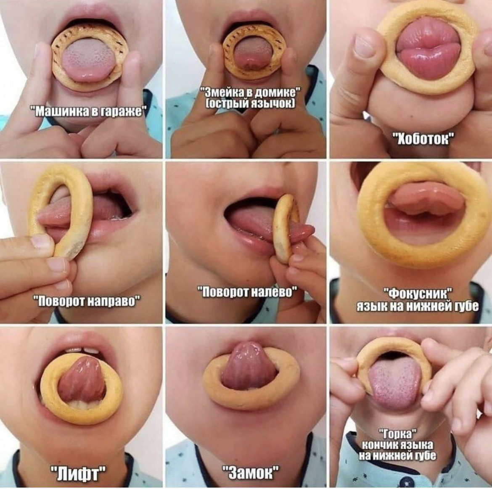

<!-- Источник: input/Соколова О.В.__Сладкая АГ.docx -->

# Сладкая артикуляционная гимнастика

## Черновое распознавание текста на изображениях

> Автоматическое распознавание Windows OCR. Возможны ошибки в словах и порядке строк. При сверке используйте изображения выше; этот раздел не является проверенным текстом автора.

### image-001.jpg

”Машинка в таваже“  
”Пововот напваво”  
”Лишт”  
”3мейка в домике“  
(оствый язычок]  
”Пововот налево“  
“3амок”  
тоботок"  
”Фокусник”  
язык на нижней шве  
•товка"  
кончик языка  
на нижней губе
